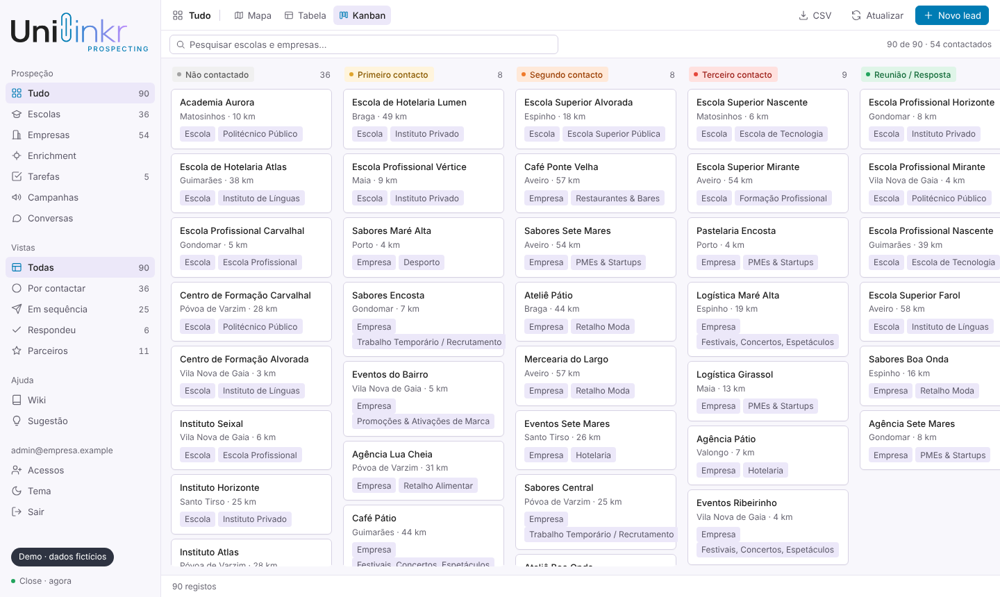
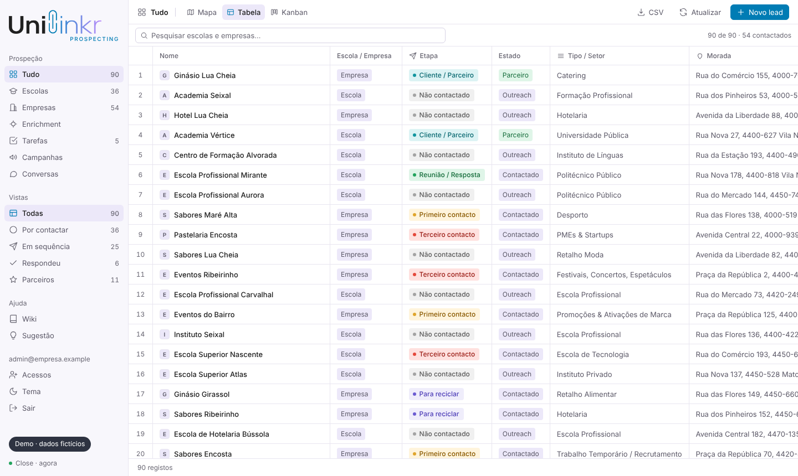
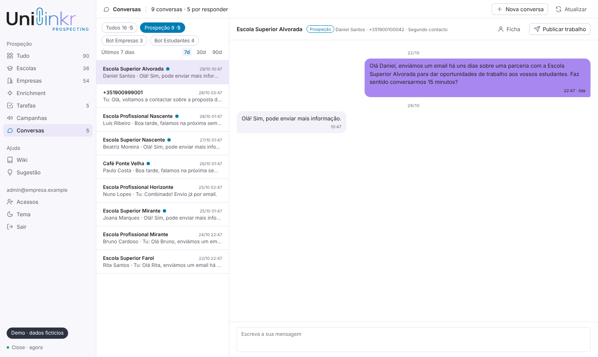

# Unilinkr Prospecting

Plataforma comercial para prospeção de escolas e empresas. Junta num só ecrã os
leads do CRM (Close) num mapa, numa tabela e num kanban por etapa, as campanhas
de email e WhatsApp, as tarefas de seguimento, o enrichment de contactos e as
conversas de WhatsApp de três remetentes, incluindo a supervisão de dois bots.

**[→ Experimentar a demo](https://joaoaguiar13.github.io/crm-prospecting-dashboard/)**: corre no browser, sem instalar nada e sem login.



> **Versão de portfólio.** Este repositório não contém dados reais: clientes,
> contactos, identificadores de contas e URLs internos foram retirados ou
> substituídos por variáveis de ambiente. Para ver a plataforma a funcionar há
> um **modo demo** com dados fictícios, que não precisa de nenhuma conta externa.

<p>
  
  
</p>

## Experimentar

### Online

A [demo no GitHub Pages](https://joaoaguiar13.github.io/crm-prospecting-dashboard/)
abre a plataforma com 90 leads, conversas de WhatsApp, campanhas e tarefas
fictícios. Dá para mudar etapas, criar leads e tarefas e enviar mensagens. As
alterações ficam só no separador e desaparecem ao recarregar a página.

### No teu computador

Precisa só do Node 22 ou mais recente. Não há `npm install`: o projeto não tem
dependências.

A mesma demo estática, servida localmente em <http://localhost:4173>:

```bash
npm run demo
```

Ou o servidor completo em modo demo, com o mesmo código que corre em produção:

```bash
DEMO_MODE=1 node server.mjs
```

No Windows:

```bat
:: cmd
set DEMO_MODE=1
node server.mjs
```

```powershell
# PowerShell
$env:DEMO_MODE=1; node server.mjs
```

Depois abre <http://localhost:3000>. A sessão é criada sozinha, com um
utilizador administrador de demonstração.

No modo demo, o Close e o Twilio são simulados ao nível das funções `close()` e
`tw()` ([`lib/demo.js`](lib/demo.js)). As rotas e a interface correm o mesmo
código que em produção e as escritas funcionam: mudar a etapa de um lead, criar
leads, contactos e tarefas, enviar mensagens e assumir conversas dos bots. Tudo
vive em memória, e reiniciar o servidor repõe os dados de partida. O mapa usa
MapLibre e tiles públicos, por isso precisa de ligação à internet.

### Como funciona a demo estática

O GitHub Pages só serve ficheiros, não corre Node. A demo aproveita o facto de
cada rota de [`api/`](api) ser um handler `Request → Response` da Web API, que
também corre no browser:

- [`demo/navegador.js`](demo/navegador.js) é carregado antes de tudo o resto.
  Intercepta o `fetch('/api/<rota>')` da interface, chama o handler de
  `api/<rota>.js` diretamente no browser e devolve a `Response`. Liga o
  `DEMO_MODE`, por isso o CRM e o Twilio são simulados pelo mesmo
  [`lib/demo.js`](lib/demo.js) do modo demo do servidor.
- Os quatro módulos do Node que as rotas importam (`fs/promises`, `path`, `os` e
  `crypto`) são trocados por equivalentes em [`demo/shims/`](demo/shims). Os
  ficheiros JSON passam a viver em memória e a Web Crypto substitui o
  `node:crypto`.
- [`scripts/construir-demo.mjs`](scripts/construir-demo.mjs) monta o site:
  copia as rotas e as bibliotecas, aponta os imports do Node para os
  equivalentes, ajusta os links para funcionarem numa subpasta e confirma que
  nenhum módulo ficou a depender do Node. Se o código mudar e o build deixar de
  acompanhar, falha com uma frase a dizer onde.
- O workflow [`demo.yml`](.github/workflows/demo.yml) corre os testes, constrói
  o site e publica-o no GitHub Pages a cada push para `main`. Os ficheiros
  gerados não ficam no repositório, por isso a demo nunca fica desatualizada em
  relação ao código.

## O que a plataforma faz

| Área | O quê |
|---|---|
| **Leads** | Escolas e empresas do CRM em mapa, tabela ou kanban, com filtros por etapa, fase, tipo e setor, distância a um ponto de referência e exportação para CSV. |
| **Etapas** | Oito etapas de outreach, de *Não contactado* a *Cliente / Parceiro*. Mudar a etapa escreve no CRM. |
| **Email** | Escrito à mão na ficha do lead e enviado pelo CRM. Cria automaticamente uma tarefa de seguimento e impede envios repetidos à mesma pessoa. |
| **Campanhas** | Templates de email e de WhatsApp por campanha, com variantes A/B. |
| **Conversas** | WhatsApp dos três remetentes (prospeção e dois bots), com janela de 7, 30 ou 90 dias, envio de templates aprovados e a opção de assumir ou devolver uma conversa ao bot. Os erros do Twilio aparecem explicados em linguagem simples, não como códigos. |
| **Tarefas** | Lista das tarefas abertas no CRM, para criar e concluir. |
| **Enrichment** | Pesquisa de contactos por domínio (Apollo ou RocketReach), com a chave guardada no servidor. |
| **Acessos** | Login Google ou por código, restrito a um domínio e a uma lista de acessos gerida na página de admin. |

## Arquitetura

```
browser ──► server.mjs ──► api/<rota>.js ──► lib/close.js   ──► Close (CRM)
             │  portão de sessão               lib/twilio.js  ──► Twilio (WhatsApp)
             │  páginas estáticas              lib/leads.js   ──► cache de leads + geocodificação
             └► index.html (aplicação inteira, sem framework)
```

- **Servidor:** `node:http` puro. O [`server.mjs`](server.mjs) converte cada
  pedido numa `Request` da Web API e encaminha `/api/<nome>` para
  `api/<nome>.js`. Cada rota é um handler `Request → Response`, por isso o
  código é portátil entre plataformas serverless e um processo Node normal.
- **Sessão:** cookie assinado com HMAC-SHA256 (Web Crypto). A cada pedido, o
  portão confirma que a pessoa continua na lista de acessos e recalcula se é
  admin. Tirar alguém da lista tem efeito imediato, sem esperar que o cookie
  expire.
- **Leads:** lidos do CRM em páginas paralelas e guardados numa cache em
  memória e em disco. Um webhook do CRM e um refresco periódico mantêm-nos
  frescos, e o browser só descarrega a lista quando a versão muda.
- **Dados locais:** pequenos ficheiros JSON (acessos, campanhas, configuração
  de enrichment) num diretório configurável, com escrita atómica
  (ficheiro temporário + rename).
- **Interface:** um único `index.html` com JavaScript sem framework e MapLibre
  para o mapa.

## Variáveis de ambiente

| Variável | Para quê |
|---|---|
| `SESSION_SECRET` | Assina o cookie de sessão. Sem ela o servidor não arranca (gera-se com `openssl rand -hex 32`). |
| `GOOGLE_CLIENT_ID` | Login com Google. |
| `ACCESS_CODE` | Alternativa ao Google: login com email do domínio + código partilhado. |
| `ALLOWED_DOMAIN` | Domínio cujas contas entram sem estar na lista de acessos. |
| `CLOSE_API_KEY` | Leitura e escrita no CRM. |
| `CLOSE_WEBHOOK_KEY` | Valida o webhook do CRM. Sem ela, o webhook recusa tudo. |
| `CLOSE_CF_ETAPA`, `CLOSE_CF_TIPO`, `CLOSE_CF_CAMPANHA`, `CLOSE_CF_VARIANTE`, `CLOSE_CF_LAT`, `CLOSE_CF_LNG`, `CLOSE_CF_FASE`, `CLOSE_CF_SEGMENTO`, `CLOSE_CF_TIPO_INST` | IDs dos campos personalizados no CRM (`cf_…`). |
| `TWILIO_ACCOUNT_SID`, `TWILIO_AUTH_TOKEN` | Conta do Twilio para o WhatsApp. |
| `TWILIO_FROM_PROSPECAO`, `TWILIO_FROM_EMPRESAS`, `TWILIO_FROM_ESTUDANTES` | Números dos três remetentes. |
| `UNILINKR_API_URL`, `UNILINKR_API_TOKEN` | Backend do produto, para assumir e devolver conversas dos bots. |
| `DATA_DIR` | Onde ficam os ficheiros JSON (por omissão `/data`). |
| `PORT` | Porta HTTP (por omissão `3000`). |
| `REFRESCAR_LEADS` | `0` desliga o refresco periódico dos leads. |
| `DEMO_MODE` | `1` liga o modo demo. |

Sem uma variável, a plataforma degrada só a área que depende dela e mostra um
erro explícito, em vez de falhar em silêncio.

## Correr com contas reais

```bash
SESSION_SECRET=$(openssl rand -hex 32) DATA_DIR=./dados node server.mjs
```

Acrescenta as variáveis das integrações que quiseres usar. O
[`railway.json`](railway.json) tem a configuração de deploy na Railway, mas
qualquer host Node 22 serve. A lista de acessos começa com os utilizadores de
exemplo definidos em [`lib/access.js`](lib/access.js) e gere-se depois na
página `/admin`.

## Testes

```bash
npm test
```

Corre duas coisas:

1. **[`scripts/verificar.mjs`](scripts/verificar.mjs)**, uma verificação
   estática sem dependências. Confirma a sintaxe de todo o JavaScript, incluindo
   os `<script>` inline, que todos os handlers inline existem, que os
   remetentes batem certo entre a interface e o servidor, que as variáveis CSS
   usadas estão definidas e que tudo o que o `package.json` refere está
   versionado. Usa `git ls-files`, por isso precisa de correr dentro de um
   repositório git.
2. **148 testes de comportamento** com `node:test`: portão de sessão e lista de
   acessos, login por código, limites das campanhas, envio de email, mapeamento
   dos leads do CRM, geocodificação, cache, tarefas, erros do Twilio, modo demo
   e o build da demo estática. Este último constrói o site e chama as rotas
   construídas sem o Node por baixo.

O workflow em [`.github/workflows/verificar.yml`](.github/workflows/verificar.yml)
corre o mesmo em cada push e pull request, e o [`demo.yml`](.github/workflows/demo.yml)
volta a corrê-lo antes de publicar a demo.

## Estrutura

| | |
|---|---|
| [`server.mjs`](server.mjs) | servidor HTTP, portão de sessão, encaminhamento de `/api/*` |
| [`api/`](api) | uma rota por ficheiro (`Request → Response`) |
| [`lib/close.js`](lib/close.js) | cliente do CRM e campos personalizados |
| [`lib/twilio.js`](lib/twilio.js) | cliente do Twilio e os três remetentes |
| [`lib/leads.js`](lib/leads.js), [`lib/leads-close.js`](lib/leads-close.js) | leitura, cache e geocodificação dos leads |
| [`lib/session.js`](lib/session.js), [`lib/portao.js`](lib/portao.js), [`lib/access.js`](lib/access.js) | sessão, portão e lista de acessos |
| [`lib/demo.js`](lib/demo.js) | modo demo: dados fictícios e simulação do CRM e do Twilio |
| [`demo/`](demo) | a demo estática no browser: intercepção do `fetch` e equivalentes dos módulos do Node |
| [`index.html`](index.html), [`login.html`](login.html), [`admin.html`](admin.html) | a interface |
| [`scripts/`](scripts) | build da demo estática, verificação, cópia de segurança e sonda de produção |
| [`imagens/`](imagens) | capturas de ecrã do README |
| [`seed-campanhas.mjs`](seed-campanhas.mjs) | cria os templates e campanhas iniciais |
| [`n8n-sequencia-outreach.py`](n8n-sequencia-outreach.py) | registo de uma sequência antiga em n8n, desligada e substituída pela plataforma |
| [`test/`](test) | testes de comportamento (`node --test`) |
